# Ibaba Life-saver 🚁🩸

**Reinforcement learning for blood-delivery drones in Rwanda.**

A drone carries blood from a hub in Kigali to a district hospital, drops it by parachute and flies home.
Four agents learn to fly it with **TorchRL**: DQN, REINFORCE, PPO and A2C. *Ibaba* means "wing" in Kinyarwanda.

<p align="center">
  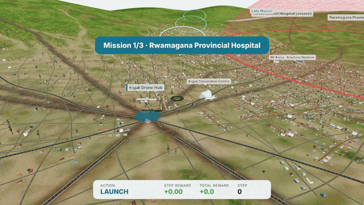
  <br><em>The trained PPO agent takes off from the Kigali hub, next to the Convention Centre, and flies through the three corridor rings.</em>
</p>

**Contents:**
[One mission](#one-mission-step-by-step) ·
[Why RL](#why-reinforcement-learning) ·
[Quick start](#quick-start) ·
[Watching the agent](#watching-the-agent) ·
[Environment](#the-environment) ·
[Training](#training) ·
[Results](#results) ·
[API](#using-the-agent-from-other-apps-api) ·
[Project layout](#project-layout) ·
[Limits](#notes-and-limits)

---

## One mission, step by step

Every mission follows the same path. The agent decides every move; nothing in it is scripted.

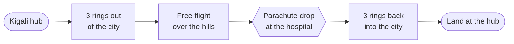

**1. Launch and corridor rings.** The drone leaves the hub (GIF at the top) and must pass three rings, 2.5, 5 and 7.5 km out.
The rings keep drones in a safe corridor out of the city and away from the airport's no-fly zone. Each ring is +10, a missed ring −10.

**2. Flight over the hills.** After the rings, the agent picks its own route. It holds a safe height above Rwanda's hills,
deals with wind and rain, and manages its battery.

<p align="center">
  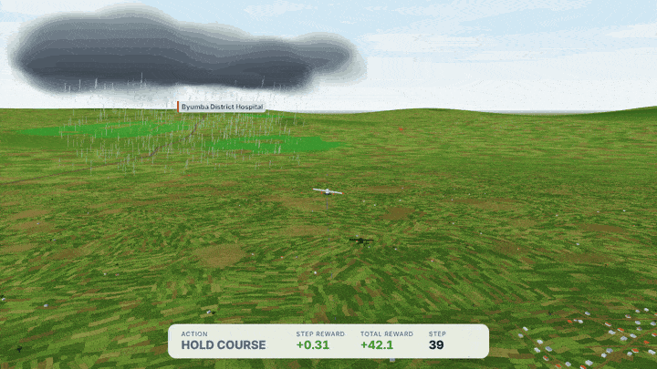
  <br><em>On the way to Byumba District Hospital the drone crosses the edge of a rain cell. Rain costs −0.8 per step and drains the battery faster, so the step reward turns red until it is out.</em>
</p>

**3. Parachute drop.** Near the hospital the agent slows down, descends to about 70 m and releases the blood box.
The box must land within 300 m of the hospital. The agent sees the predicted landing point, so it can time the release against the wind.

<p align="center">
  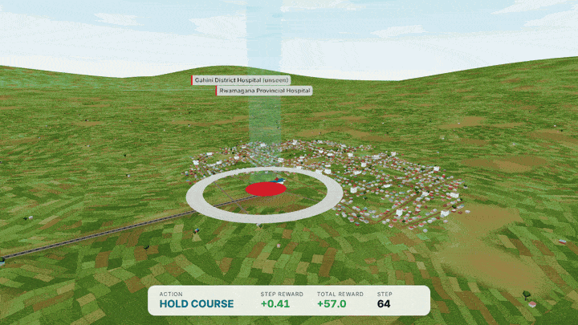
  <br><em>Seen from beside Rwamagana Provincial Hospital: slow down, descend, release. The parachute lands inside the 300 m drop zone (white ring) 25 minutes after take-off.</em>
</p>

**4. Return and landing.** With the box gone, the drone flies back through the three rings in reverse order and lands at the hub.
It gets a bonus for battery left. At the end of the tour the viewer shows a summary of all missions.

<p align="center">
  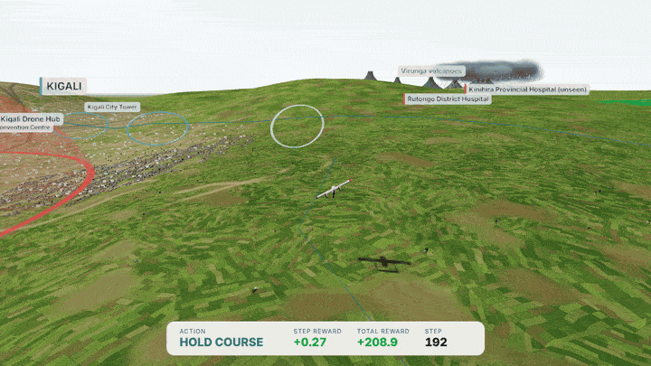
  <br><em>Back through the rings, landing at the hub, and the tour summary: 3 of 3 missions completed.</em>
</p>

In this recorded demo (seed 16), PPO completes all three missions. That includes Gahini District Hospital, which it never saw in training.
All drops land on target and the drone passes all 18 rings. Rewards: +292.0, +278.4 and +299.0.

## Why reinforcement learning

Drone delivery of blood is already national infrastructure in Rwanda, and faster blood saves mothers.
A 2026 peer-reviewed study linked drone delivery to a 46% drop in maternal deaths from postpartum haemorrhage in the hospitals served.

Each flight is a chain of 100–300 decisions that affect each other:

* how fast to fly (speed costs battery),
* when to climb over a ridge,
* whether to go around a rain cell,
* when to release the parachute,
* how much battery to keep for the trip home.

A choice made now only pays off, or fails, many minutes later. A single prediction or a shortest-path route cannot capture that.
An agent that learns from the outcome of whole flights can.

## Quick start

You only need [uv](https://docs.astral.sh/uv/). It installs the right Python and every package.

```bash
# install uv once
# Windows (PowerShell):  powershell -ExecutionPolicy ByPass -c "irm https://astral.sh/uv/install.ps1 | iex"
# macOS / Linux:          curl -LsSf https://astral.sh/uv/install.sh | sh

git clone -b alan https://github.com/ai-ngabo/alain-ngabo_rl_summative.git
cd alain-ngabo_rl_summative
uv sync            # installs everything from pyproject.toml / uv.lock
uv run play.py     # the best agent (PPO) flies a 3-mission tour in the 3D viewer
```

The browser opens the viewer at `http://127.0.0.1:8765/` (open it yourself if it does not).
The trained models are already in `models/`, so you don't need to train anything first.

## Watching the agent

`uv run play.py` runs the agent in two places at once: the 3D viewer in the browser and a log in the terminal.
The terminal shows the agent's decisions: step, action, speed, height, battery, phase, reward and events.

<p align="center">
  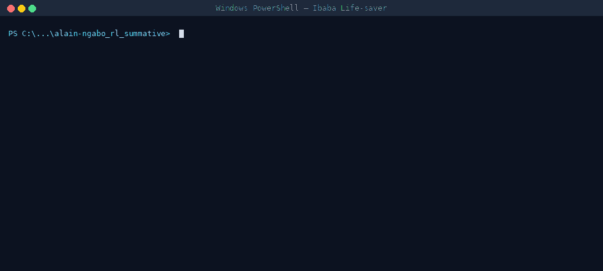
  <br><em>Terminal-only run (<code>--no-gui</code>): ring rewards, the delivery bonus (+116) and the landing bonus (+53).</em>
</p>

**In the viewer:**

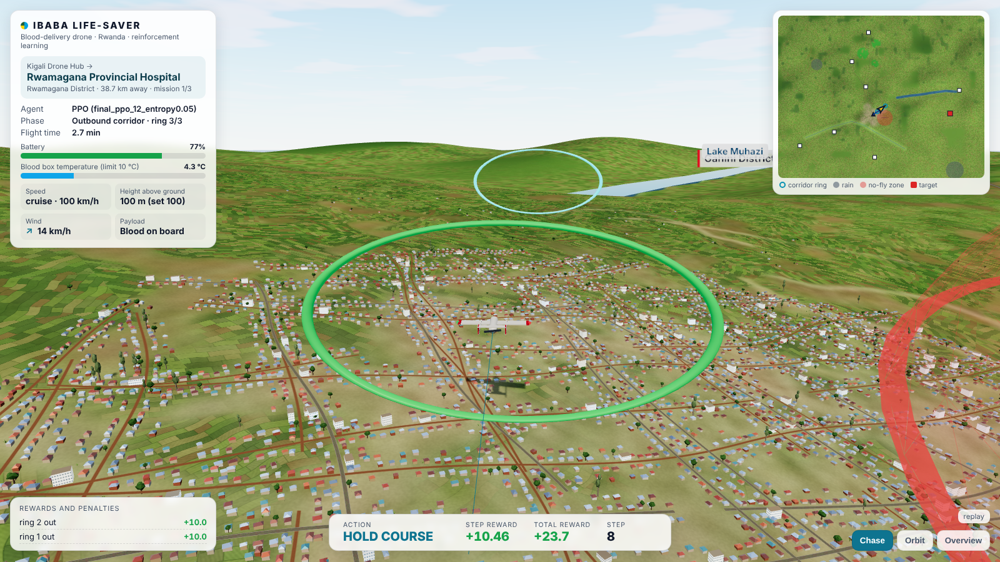

* **Left panel:** the mission, phase, battery, blood temperature (must stay ≤ 10 °C), speed, height and wind.
* **Bottom bar:** the action the agent just chose, its reward and the total reward so far.
* **Top right:** a minimap with the rings, rain cells, no-fly zone and target.
* **Bottom left:** a list of rewards and penalties.
* **Cameras:** the **Chase**, **Orbit** and **Overview** buttons, or the keys `C`, `O` and `M`. In Orbit mode, drag with the mouse to look around.

**Commands:**

| Command | What it does |
|---|---|
| `uv run play.py` | the best agent (PPO) flies a 3-mission tour (about 3 min) |
| `uv run play.py --algo dqn` | watch one agent: `dqn`, `reinforce`, `ppo`, `a2c` or `heuristic` (hand-written autopilot) |
| `uv run play.py --split test --random` | missions to the two hospitals never seen in training |
| `uv run play.py --hospital "Byumba District Hospital"` | one specific hospital |
| `uv run play.py --no-gui` | terminal only, no browser |
| `uv run play.py --intro 0` | skip the 3-second launch shot |
| `uv run main.py train --algo ppo` | train one agent (a few minutes on a laptop CPU) |
| `uv run main.py sweep` | all 48 hyperparameter runs (12 per algorithm) |
| `uv run main.py analyze` | tables, figures and `models/best_models.json` from the logs |
| `uv run main.py evaluate` | re-score the best models on 30 + 30 fixed missions |
| `uv run main.py api` | serve the trained agent over HTTP ([API](#using-the-agent-from-other-apps-api)) |
| `uv run python -m pytest tests -q` | environment tests |

**Viewer options** (add them to the URL):

| Option | Effect |
|---|---|
| `?quality=low` | lighter graphics for slow laptops: no shadows, fewer trees. The viewer also drops shadows by itself below 24 fps |
| `?quality=high` | always keep shadows on |
| `?nointro=1` | skip the launch shot |
| `?replay=replays/demo.json` | play the recorded demo without Python (see below) |

**Replay without Python:** serve the viewer folder with any web server, then open the replay:

```bash
cd assets/viewer
uv run python -m http.server 8000
# open http://127.0.0.1:8000/?replay=replays/demo.json
```

The GIFs in this README were recorded from that replay file.

## The environment

`environment/custom_env.py` defines `IbabaDroneEnv`, a [Gymnasium](https://gymnasium.farama.org/) environment.

**Map.** A 104 × 82 km area around Kigali, built from real coordinates. It includes:

* the Kigali hub,
* Kigali International Airport and its 4 km no-fly zone,
* Lake Muhazi, Mount Kigali and Mount Jali,
* 8 real hospitals.

Six hospitals are used for training. Kinihira Provincial Hospital and Gahini District Hospital are held out to test generalization.

**Time.** One step is 20 seconds of flight. A mission can last at most 300 steps (100 minutes).

### Actions (8, discrete)

| # | Action | Effect |
|---|---|---|
| 0 | hold course | keep heading, speed and height |
| 1 | turn left | turn 30° left |
| 2 | turn right | turn 30° right |
| 3 | climb | height setpoint +30 m (range 40–200 m) |
| 4 | descend | height setpoint −30 m |
| 5 | speed up | slow -> cruise -> fast (60 / 100 / 130 km/h) |
| 6 | slow down | fast -> cruise -> slow |
| 7 | release payload | drop the blood box (works only within 1 km of the hospital) |

### Observations (27 numbers)

Every value is scaled to a small range so the networks learn easily.

| Index | Meaning | Encoding |
|---|---|---|
| 0–1 | direction to the next waypoint, relative to the heading | sin, cos |
| 2 | distance to the next waypoint | km / 50 |
| 3 | next waypoint is a corridor ring | 0 or 1 |
| 4–6 | mission phase: outbound rings, to the hospital, return | one-hot |
| 7 | height above the ground | m / 200 |
| 8–9 | clearance above the terrain 1 km and 2.5 km ahead | m / 200 |
| 10 | autopilot height setpoint | m / 200 |
| 11 | speed level | 0, 0.5, 1 |
| 12 | battery left | 0 to 1 |
| 13–14 | tailwind and crosswind | m/s / 12 |
| 15 | inside a rain cell | 0 or 1 |
| 16–18 | direction and distance to the nearest rain cell | sin, cos, km / 10 |
| 19–21 | direction and distance to the airport no-fly zone | sin, cos, km / 10 |
| 22 | blood still on board | 0 or 1 |
| 23 | blood box warming since launch | (°C − 4) / 6 |
| 24 | time used | step / 300 |
| 25 | distance from the hub | km / 50 |
| 26 | predicted parachute landing error | km / 3 |

**State carried from step to step:**

* **Battery** drains faster at high speed, when climbing and in rain.
* **Blood temperature** rises 0.1 °C per minute and must stay ≤ 10 °C.
* **Rain cells** drift with the wind.
* **Height** follows the terrain, with a limited climb rate.

### Rewards

| Event | Reward |
|---|---|
| progress toward the next waypoint | +1 per km |
| pass a corridor ring / miss one | +10 / −10 |
| blood delivered on target (within 300 m) | +100, plus up to +40 for beating the real 42-minute average |
| blood lands off target but within 1 km (recovered late) | +30 |
| blood lost / too warm on delivery | −100 / only +20 |
| land at the hub | +50, plus up to +20 for battery left (only +10 if the blood was not delivered) |
| each step with blood on board / empty | −0.15 / −0.05 (the patient is waiting) |
| flying in rain, outside the 60–150 m height band, too close to the ground | −0.8, −0.3, −1 per step |
| crash, empty battery, no-fly zone, leaving the map | −100 and the episode ends |

**Episode ends** when the drone lands home (success), crashes, runs out of battery, enters the no-fly zone, leaves the map, or reaches 300 steps.

## Training

All agents use TorchRL and the same budget: **250,000 environment steps** per sweep run.

| Algorithm | Type | TorchRL pieces | File |
|---|---|---|---|
| DQN | value-based | `QValueActor`, `EGreedyModule`, `DQNLoss` (double DQN), `ReplayBuffer`, `HardUpdate` / `SoftUpdate` | `training/dqn_training.py` |
| REINFORCE | policy gradient | `ProbabilisticActor`, `ReinforceLoss`, Monte-Carlo returns, optional value baseline | `training/pg_training.py` |
| PPO | policy gradient | `ClipPPOLoss`, `GAE`, minibatch epochs | `training/pg_training.py` |
| A2C | policy gradient | `A2CLoss`, `GAE` (n-step / GAE / TD(0)) | `training/pg_training.py` |

**Hyperparameter sweep:** 12 runs per algorithm, 48 in total.

| Algorithm | What the 12 runs change |
|---|---|
| DQN | learning rate, gamma, batch size, replay buffer size, exploration decay (fast / slow), target update (hard / soft), double DQN on/off, network width |
| REINFORCE | value baseline on/off, return normalization, learning rate, gamma, entropy, episodes per batch, network size |
| PPO | learning rate, clip range, GAE λ, epochs, batch size, entropy |
| A2C | advantage type (n-step / GAE / TD(0)), rollout length, learning rate, entropy, critic weight, gamma |

* Every run saves its full log to `logs/<algo>/<run>.json` and its model to `models/`.
* The summary tables are in `logs/summary_<algo>.csv`.
* Each algorithm's best setting was then trained again for 1M steps (`final_*` runs) and on two more seeds (`seed*` runs).

## Results

Scores are averages over 30 fixed missions to the training hospitals, plus 30 missions to the two unseen hospitals.

| Algorithm | Best configuration | Mean reward | Success | On-target drops | Delivery (min) | Unseen reward | Unseen success | Episodes to converge |
|---|---|---|---|---|---|---|---|---|
| DQN | `dqn_08_eps_slow200k` | 215.8 | 70% | 97% | 15.0 | 200.1 | 63% | 3398 |
| REINFORCE | `reinforce_06_gamma0.95` | 194.8 | 93% | 33% | 17.8 | 203.8 | 83% | 599 |
| **PPO** | `ppo_12_entropy0.05` | **249.6** | **100%** | 77% | 18.0 | **224.9** | 83% | 1443 |
| A2C | `a2c_11_critic1.0` | 193.4 | 93% | 30% | 20.4 | 172.8 | 70% | 2666 |
| Autopilot | hand-written rule | 259.7 | 93% | 100% | 19.7 | 240.6 | 83% | – |

* **PPO is the best agent.** It has the highest reward on both training and unseen hospitals, and it completed all 30 training missions. It also has the most robust sweep: 9 of 12 settings scored above 180.
* **DQN delivers fastest** (15 min) and drops most accurately, but it uses too much battery and fails more often on the way home.
* **REINFORCE converges fastest** (599 episodes), but only a third of its drops land on target.
* **No agent** entered the airport zone or ran out of time. Almost all failed missions were empty batteries on long flights.
* The hand-written autopilot still scores a little higher, mainly because every one of its drops lands on target.

| | |
|---|---|
| 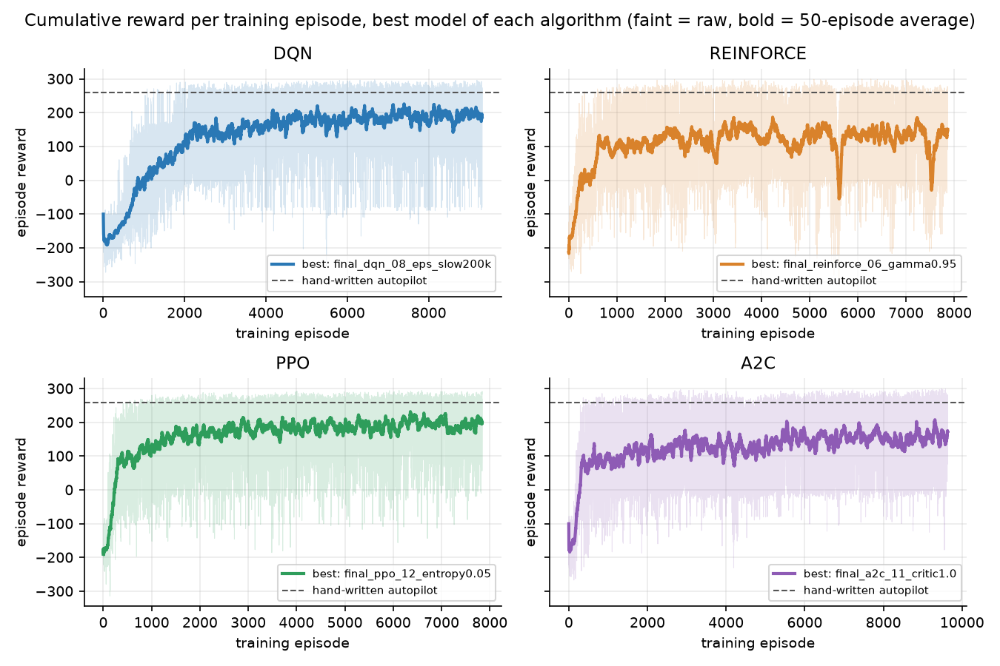 | 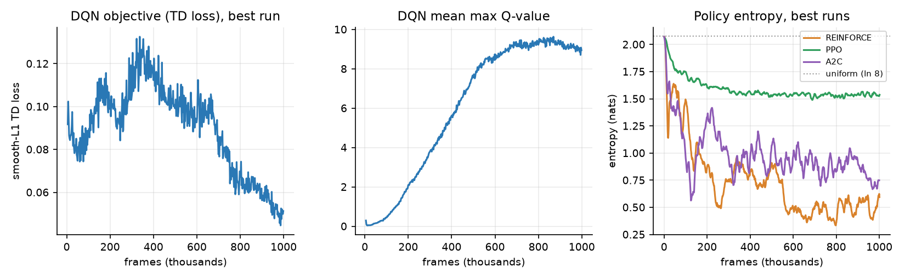 |
| 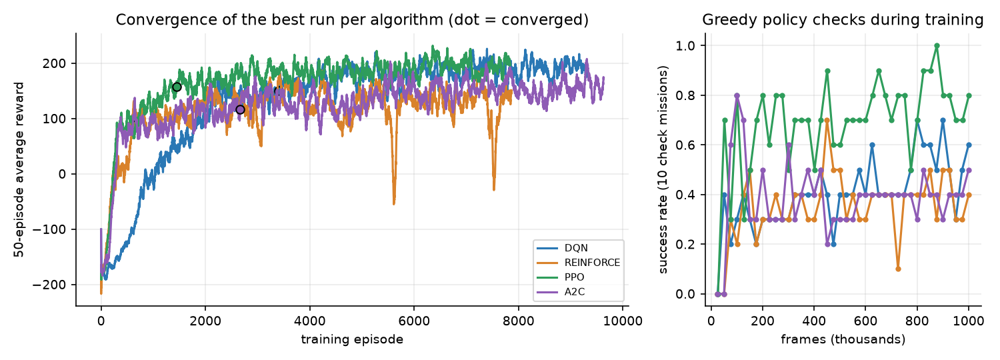 | 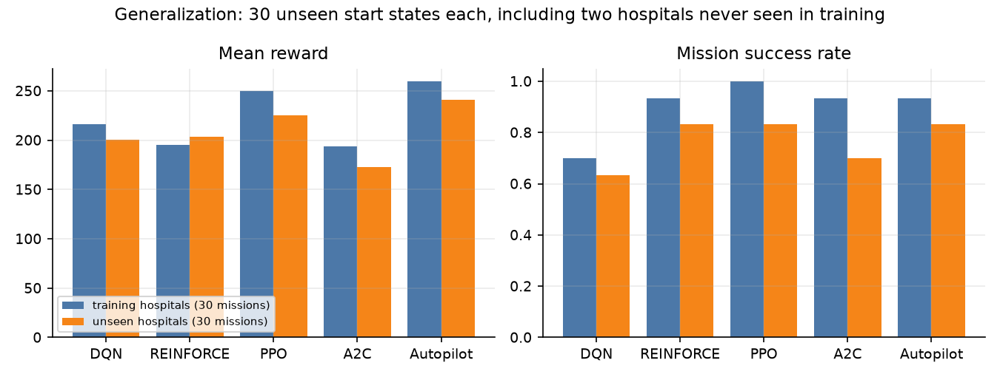 |

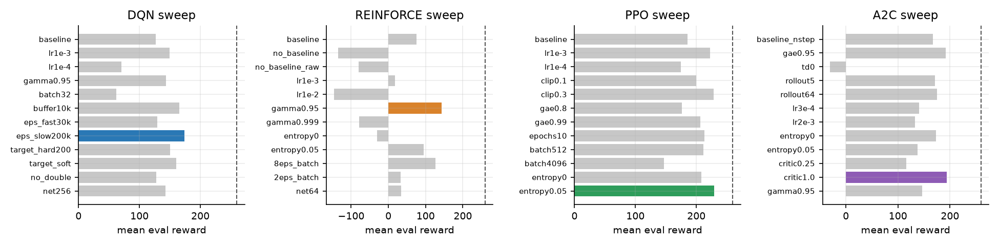

**To reproduce everything** (several hours on a laptop CPU):

```bash
uv run main.py sweep                          # 48 runs
uv run python -m training.sweep --stage seeds
uv run python -m training.sweep --stage final # 1M-step runs, 17–40 min each
uv run main.py analyze
```

## Using the agent from other apps (API)

The trained agent is a plain PyTorch network, saved with its config in `models/`.
`uv run main.py api` serves it over HTTP with FastAPI.

<p align="center">
  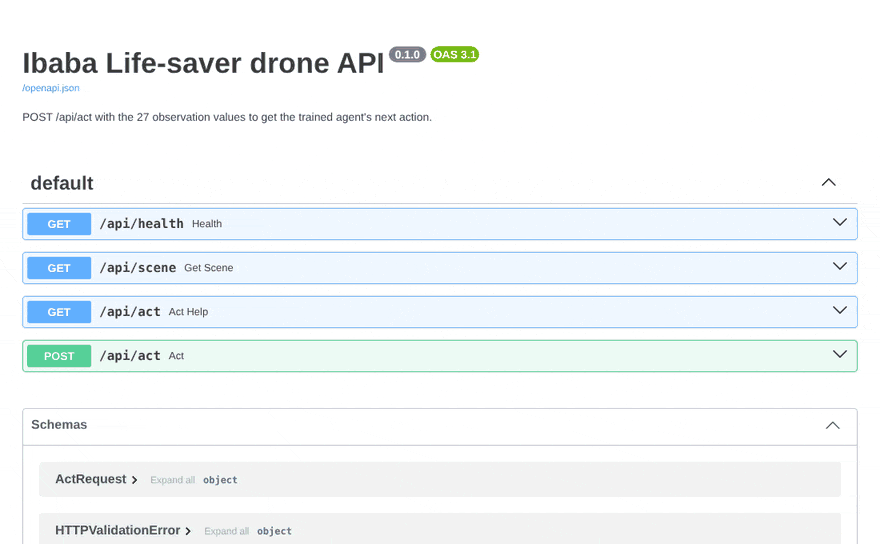
  <br><em>Open <code>http://127.0.0.1:8765/docs</code>, choose <code>POST /api/act</code>, then <b>Try it out</b> and <b>Execute</b>.</em>
</p>

Or call it from any language:

```bash
curl -X POST http://127.0.0.1:8765/api/act -H "Content-Type: application/json" \
     -d '{"observation": [0.1, 0.99, 0.4, 1, 1, 0, 0, 0.5, 0.45, 0.4, 0.5, 0.5, 0.9, 0.1, 0.05, 0, 0, 0, 1, 0.6, 0.2, 0.3, 1, 0.05, 0.1, 0.02, 1.0]}'
```

```json
{"action": 0, "action_name": "hold course", "scores": [2.7173, 1.8283, -0.216, 2.2031, 1.6136, 2.2048, 0.4837, -10.7721]}
```

| Endpoint | Use |
|---|---|
| `POST /api/act` | send 27 observation values, get the next action |
| `GET /api/act` | help: how to call it, with an example body |
| `GET /api/health` | check that the server is up and a policy is loaded |
| `GET /docs` | interactive API page |

A dispatch dashboard or a mobile app would send the drone's readings (GPS, altimeter, battery, weather) and get back the next manoeuvre.
The 3D viewer is itself a client of the same server, over a WebSocket (`/ws`).

## Project layout

```
├── main.py                 command line: play, train, sweep, analyze, evaluate, api
├── play.py                 runs the best agent with the 3D viewer and terminal log
├── environment/
│   ├── custom_env.py       IbabaDroneEnv (Gymnasium) + hand-written autopilot baseline
│   ├── world.py            Rwanda map: hospitals, airport, lake, terrain, villages, roads
│   └── rendering.py        viewer and API server (FastAPI + WebSocket)
├── training/               dqn_training.py, pg_training.py, common.py, sweep.py, analysis.py
├── models/                 every run's trained policy + best_models.json
├── logs/                   every run's full log, summary CSVs, evaluation results
├── assets/
│   ├── viewer/             3D viewer (three.js), terrain texture, demo replay
│   ├── figures/            report figures and viewer screenshots
│   └── gifs/               the GIFs in this README
└── tests/                  environment tests
```

## Notes and limits

* **Simulated, not surveyed.** Hospital positions come from public map coordinates. The hills are a smooth heightfield with Rwanda-like relief.
* **Drone figures are public estimates:** cruise about 100 km/h, flight height 80–120 m.
* **Hub location.** The real drone hubs are in Muhanga and Kayonza. This project puts its hub in Kigali so the city appears in the simulation.
* **3D city.** The viewer's buildings, roads and landmarks are modelled to look like Kigali. They are for display only and do not affect the agent.

---

Alain Ngabo · African Leadership University · Reinforcement Learning summative
